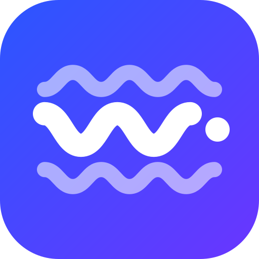
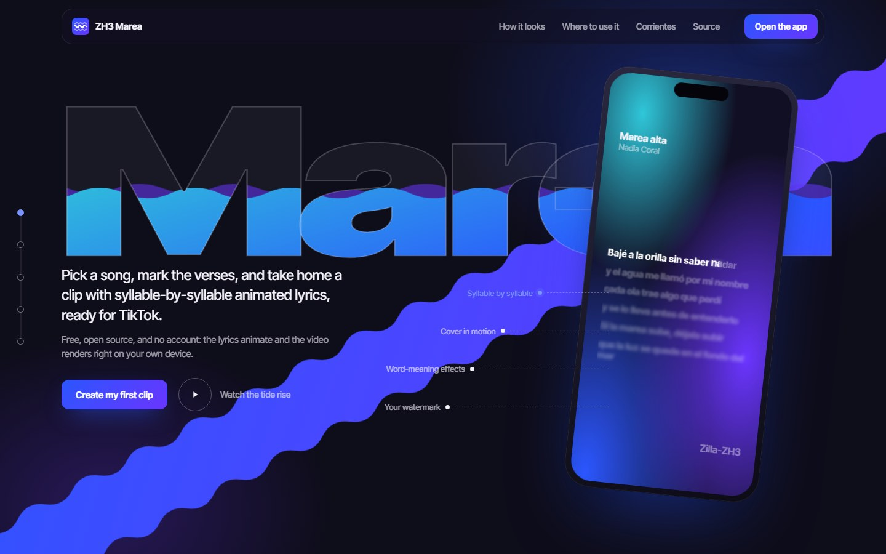
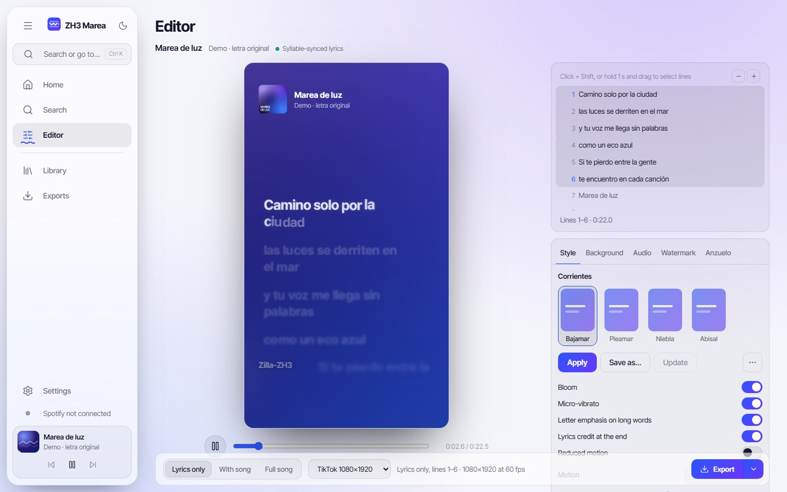
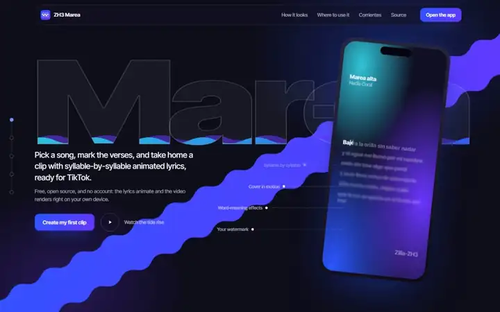
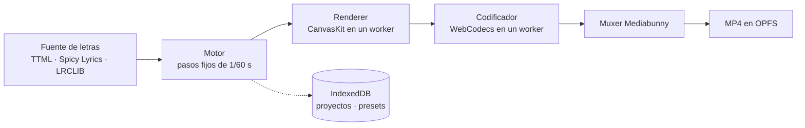

[English](README.md) · Español

<div align="center">



# ZH3 Marea Web

**Clips de letras sincronizadas sílaba por sílaba, estilo Apple Music, para TikTok, hechos por completo en tu navegador.**

[Sitio en vivo][live] · [App de escritorio](https://github.com/zillazh3/ZH3-Marea) · [Reportar un bug](https://github.com/zillazh3/ZH3-Marea-Web/issues) · [README (English)](README.md)

[](https://github.com/zillazh3/ZH3-Marea-Web/actions/workflows/ci.yml)
[](LICENSE)
[](https://github.com/zillazh3/ZH3-Marea/releases/latest)



</div>

ZH3 Marea convierte una canción y un rango de versos en un MP4 vertical con la letra animada, un fondo con la portada difuminada
y tu marca de agua. Esta es la versión web de la [app de escritorio](https://github.com/zillazh3/ZH3-Marea). No hay servidor ni
cuenta: la vista previa, la codificación y tus proyectos corren en tu dispositivo.

<div align="center">





</div>

> Las capturas muestran la interfaz en inglés; la app también está en español (México) y sigue el idioma de tu navegador.

## Qué hace

- Resalta la letra **sílaba por sílaba**, a partir de archivos TTML, Spicy Lyrics (con tu propia llave, opcional) o LRCLIB.
- Trae cuatro **Corrientes** (estilos prediseñados) y te deja guardar, importar y exportar las tuyas como `.json`.
- Sugiere rangos de versos para una duración objetivo con **Anzuelo**, según coros repetidos, menciones del título y, con audio, picos de voz.
- Agrega **efectos semánticos por palabra** opcionales: palabras como «tiempo» o «amor» reaccionan a su significado (experimental, desactivado de inicio).
- Exporta MP4 de **1080×1920**, 1080×1080 o 1920×1080 a **60 fps** sin salir del navegador.
- Funciona en celulares y se instala como PWA.
- No pide cuenta y no sube nada: proyectos, audio y exportaciones se quedan en el almacenamiento de tu navegador.

## Cómo funciona

Todo corre en el cliente. El proveedor de letras entrega las sílabas con sus tiempos, el motor avanza la animación en pasos fijos
de 1/60 s, CanvasKit dibuja cada cuadro en un worker y un codificador WebCodecs alimenta a Mediabunny, que escribe el MP4 en el
sistema de archivos privado del navegador (OPFS). Los proyectos viven en IndexedDB. Los archivos `.marea.json` y los `.json` de
las Corrientes usan los mismos esquemas que la app de escritorio.



## Privacidad

Nada de lo que haces sale de tu dispositivo. Las únicas peticiones de red van a los servicios de letras y música que decidas usar
(LRCLIB, Spicy Lyrics, Spotify), y no hay analíticas. La lista completa de qué se guarda y dónde está en la
[página de privacidad][live-privacidad] y en [docs/privacy-and-storage.md](docs/privacy-and-storage.md) (en inglés).

## Primeros pasos

Necesitas Node.js 22.12 o más reciente (`engines` en [package.json](package.json)) y npm.

```sh
git clone https://github.com/zillazh3/ZH3-Marea-Web.git
cd ZH3-Marea-Web
npm install
npm run dev
```

El servidor de desarrollo escucha en `127.0.0.1:5173`, no en `localhost`, porque Spotify rechaza los Redirect URI con `localhost`.

| URL                          | Qué es                                          |
| ---------------------------- | ----------------------------------------------- |
| `http://127.0.0.1:5173/`     | Página de inicio (español); `/en/` en inglés    |
| `http://127.0.0.1:5173/app/` | La app                                          |

Pulsa **Probar con la canción demo** en el inicio de la app para ver el Editor sin cuenta ni archivos.

### Spotify (opcional)

Spotify solo se usa para buscar portadas y mostrar lo que suena. Cada persona usa su propia app, igual que en la versión de escritorio:

1. Crea una app en el [panel de Spotify](https://developer.spotify.com/dashboard).
2. Agrega `http://127.0.0.1:5173/app/` a sus Redirect URIs, con la diagonal final.
3. Abre **Ajustes → Spotify** en la app, pega el Client ID y conecta.

Ajustes muestra el Redirect URI exacto de la página donde estás, con un botón para copiarlo. El mismo flujo sirve en producción con
la dirección del sitio (mira [docs/deploy.md](docs/deploy.md), en inglés).

## Scripts

| Comando                    | Qué hace                                                                                       |
| -------------------------- | ---------------------------------------------------------------------------------------------- |
| `npm run dev`              | Servidor de desarrollo de Vite                                                                 |
| `npm run build`            | Build de producción en `dist/`                                                                 |
| `npm run preview`          | Sirve `dist/` con el servidor de vista previa de Vite                                          |
| `npm run check`            | Typecheck, lint, formato y pruebas unitarias; córrelo antes de un PR                           |
| `npm run typecheck`        | `svelte-check` con los avisos tratados como errores                                            |
| `npm run lint`             | ESLint, incluidas las reglas de imports entre capas                                            |
| `npm run format`           | Prettier en modo escritura (`format:check` solo reporta)                                       |
| `npm test`                 | Pruebas unitarias con Vitest                                                                   |
| `npm run test:e2e`         | Pruebas de Playwright contra el servidor de desarrollo                                         |
| `npm run test:e2e:static`  | Compila, sirve `dist/` con `wrangler dev` y falla ante violaciones de CSP o errores de consola |
| `npm run preview:static`   | Compila y sirve `dist/` con el `_headers` real en `http://127.0.0.1:8787`                      |
| `npm run smoke -- <url>`   | Revisiones posteriores al deploy: páginas, redirección de `/app`, página 404 y headers         |
| `npm run deploy`           | Corre `check`, compila y ejecuta `wrangler deploy`; publica de verdad                          |

## Estructura del proyecto

```text
app/, en/, privacidad/   Puntos de entrada HTML: app, inicio en inglés, privacidad en español
public/                  Archivos estáticos tal cual: _headers, íconos, imagen OG
src/
  shared/                Utilidades puras: matemáticas compatibles con Python, hashes, config del sitio
  engine/                Motor de animación, sin DOM
  render/                Dibuja un cuadro a partir del estado del motor (CanvasKit)
  export/                Worker de exportación, codificadores, estado de los trabajos
  features/              Letras, proveedores, proyectos, presets, Anzuelo, efectos por palabra, almacenamiento, i18n
  ui/                    Componentes Svelte, pantallas, router, tokens de diseño
  landing/               Scripts y estilos de la página de inicio (TypeScript sin framework)
  assets/                Datos incluidos: pesos de Anzuelo, biblioteca de efectos por palabra
tests/                   Reglas de arquitectura, paridad con la app de escritorio, revisiones de PWA y landing
e2e/, e2e-static/        Pruebas de Playwright: servidor de desarrollo y build de producción con headers
tools/                   Plugins de build, renderizador del landing, smoke test, generadores de fixtures
docs/                    Guía de deploy, referencia de privacidad y almacenamiento
```

Los imports solo apuntan hacia adentro (`shared` → `engine` → `render` → `export` → `features` → `ui`) y ESLint lo hace cumplir.

## Tecnologías

- **Vite y TypeScript (strict)**, con Svelte 5 para la app: salida compilada pequeña y sin capas extra de router o framework.
- **TypeScript sin framework para el landing**, prerenderizado a HTML estático para que cargue antes que cualquier framework.
- **CanvasKit (Skia en WebAssembly)** en un worker: las mismas primitivas de dibujo que la app de escritorio y suficiente velocidad en celulares.
- **WebCodecs y Mediabunny**, en un worker: codificación determinista cuadro por cuadro sin bloquear la interfaz.
- **Pruebas de paridad del motor**: el motor se compara con valores grabados de la app de escritorio.
- **IndexedDB (`idb`) y OPFS** para proyectos, presets y archivos grandes.
- **Vitest y Playwright** para pruebas unitarias y de extremo a extremo, más Lighthouse CI.
- **Cloudflare Workers con assets estáticos**: un sitio estático en el plan gratuito de `workers.dev`, con headers de seguridad por ruta.

## Deploy

1. `npx wrangler login` y luego `npm run deploy` para el primer deploy.
2. Conecta el repositorio a Workers Builds para que cada push a `main` salga en vivo.
3. Agrega el Redirect URI de producción (`https://<tu-sitio>/app/`) a tu app de Spotify.

Los detalles, incluidos `VITE_SITE_URL`, rollbacks y dominios propios, están en [docs/deploy.md](docs/deploy.md) (en inglés).

## Compatibilidad con navegadores

La app necesita WebCodecs (para exportar MP4), OffscreenCanvas con WebGL (para los workers de vista previa y exportación),
IndexedDB y OPFS (para proyectos y archivos).

Las pruebas de extremo a extremo corren solo en Chromium 159 (Playwright 1.65). Otros navegadores con las mismas APIs pueden
funcionar, pero no están probados, así que este README no promete versiones mínimas para ellos.

Sin WebCodecs la app abre, pero exportar un MP4 falla con un mensaje que lo explica. Aun así puedes descargar tu proyecto como
`.marea.json` y terminarlo en la app de escritorio.

## Cómo contribuir

Los issues y pull requests son bienvenidos, en español o en inglés. La configuración, las revisiones que debes correr y las
reglas de código están en [CONTRIBUTING.md](CONTRIBUTING.md) (en inglés).

## Relacionado

[ZH3 Marea para Windows](https://github.com/zillazh3/ZH3-Marea) es la app de escritorio. Además de lo que hace la versión web,
captura el audio del sistema, exporta la canción completa, incluye un laboratorio experimental de sincronía automática de
letras y se distribuye como un `.exe` portable.

Los proyectos (`.marea.json`) y las Corrientes (`.json`) usan los mismos esquemas en ambas. Descarga un proyecto desde la
Biblioteca aquí y ábrelo en la app de escritorio, o al revés. El audio no va dentro del archivo, así que te pedirá el archivo de
audio de nuevo.

## Créditos

ZH3 Marea se apoya en el trabajo de otras personas: Apple Music-like Lyrics (AMLL), Spicy Lyrics y `spr` para los valores de la
animación, LRCLIB y Spicy Lyrics como fuentes de letras, Inter Tight para la tipografía y Lucide para los íconos. La lista
completa y las licencias están en [THIRD_PARTY.md](THIRD_PARTY.md).

Spotify, TikTok y Apple Music son marcas de sus respectivos dueños. Este proyecto no tiene afiliación ni respaldo de ellos.

## Licencia

[GNU AGPL-3.0](LICENSE). Si modificas esta app y la pones a disposición de otras personas por red, debes publicar tus cambios
bajo la misma licencia.

[live]: https://zh3marea.thezillax.workers.dev/
[live-privacidad]: https://zh3marea.thezillax.workers.dev/privacidad/
