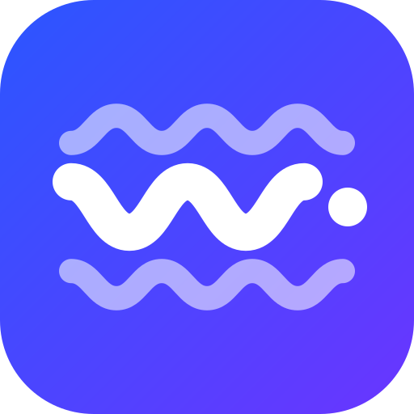
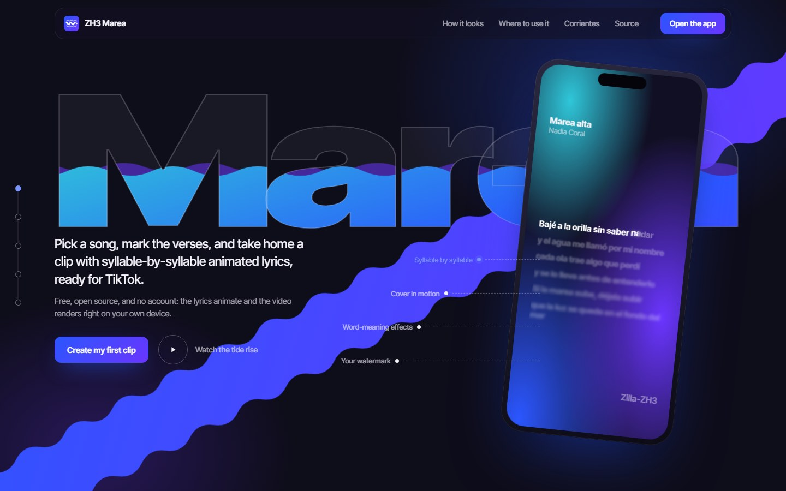
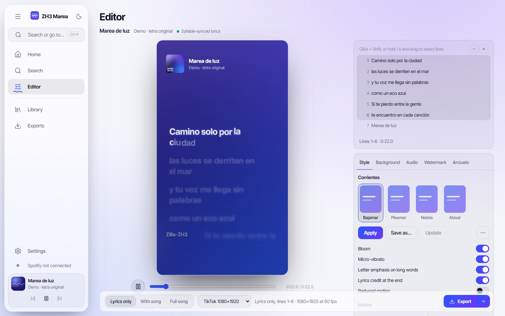
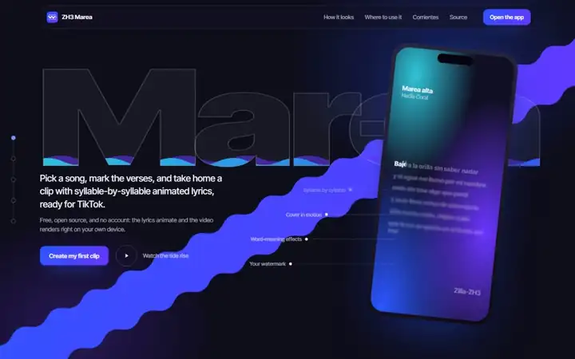
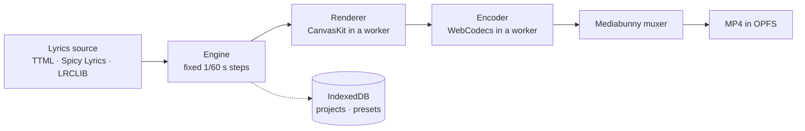

English · [Español](LEEME.md)

<div align="center">



# ZH3 Marea Web

**Apple Music–style, syllable-synced lyric clips for TikTok, made entirely in your browser.**

[Live site][live] · [Desktop app](https://github.com/zillazh3/ZH3-Marea) · [Report a bug](https://github.com/zillazh3/ZH3-Marea-Web/issues) · [LEEME (Español)](LEEME.md)

[](https://github.com/zillazh3/ZH3-Marea-Web/actions/workflows/ci.yml)
[](LICENSE)
[](https://github.com/zillazh3/ZH3-Marea/releases/latest)



</div>

ZH3 Marea turns a song and a range of verses into a vertical MP4 with animated lyrics, a blurred-cover background and your
watermark. This is the web version of the [desktop app](https://github.com/zillazh3/ZH3-Marea). There is no backend and no
account: the preview, the encoding and your projects all run on your device.

<div align="center">





</div>

## What it does

- Highlights lyrics **syllable by syllable**, using TTML files, Spicy Lyrics (optional key) or LRCLIB.
- Ships four **Corrientes** (style presets), and lets you save, import and export your own as `.json`.
- Suggests verse ranges for a target duration with **Anzuelo**, scoring repeated choruses, title mentions and (with audio) vocal peaks.
- Adds optional **semantic word effects**: words like "time" or "love" react to their meaning (experimental, off by default).
- Exports **1080×1920**, 1080×1080 or 1920×1080 MP4 at **60 fps** without leaving the browser.
- Works on phones and installs as a PWA.
- Needs no account and uploads nothing: projects, audio and exports stay in your browser's storage.

## How it works

Everything runs on the client. The lyrics provider returns timed syllables, the engine steps the animation in fixed 1/60 s
frames, CanvasKit draws each frame in a worker, and a WebCodecs encoder feeds Mediabunny, which writes the MP4 to the browser's
private file system (OPFS). Projects live in IndexedDB. The `.marea.json` and Corriente `.json` files use the same schemas as the
desktop app.



## Privacy

Nothing you make leaves your device. The only network requests go to the lyrics and music services you choose to use (LRCLIB,
Spicy Lyrics, Spotify), and there is no analytics. The full list of what is stored, and where, is on the
[privacy page][live-privacy] and in [docs/privacy-and-storage.md](docs/privacy-and-storage.md).

## Getting started

You need Node.js 22.12 or newer (`engines` in [package.json](package.json)) and npm.

```sh
git clone https://github.com/zillazh3/ZH3-Marea-Web.git
cd ZH3-Marea-Web
npm install
npm run dev
```

The dev server binds `127.0.0.1:5173`, not `localhost`, because Spotify rejects `localhost` redirect URIs.

| URL                          | What                                    |
| ---------------------------- | --------------------------------------- |
| `http://127.0.0.1:5173/`     | Landing page (Spanish); `/en/` English  |
| `http://127.0.0.1:5173/app/` | The app                                 |

Press **Try the demo song** on the app's home screen to see the Editor without any account or file.

### Spotify (optional)

Spotify is only used for cover-art search and now playing. Each person uses their own app, as in the desktop version:

1. Create an app in the [Spotify dashboard](https://developer.spotify.com/dashboard).
2. Add `http://127.0.0.1:5173/app/` to its Redirect URIs, trailing slash included.
3. Open **Settings → Spotify** in the app, paste the Client ID and connect.

Settings shows the exact Redirect URI of the page you are on, with a copy button. The same flow works in production with that
site's address (see [docs/deploy.md](docs/deploy.md)).

## Scripts

| Command                    | What it does                                                                          |
| -------------------------- | ------------------------------------------------------------------------------------- |
| `npm run dev`              | Vite dev server                                                                       |
| `npm run build`            | Production build in `dist/`                                                           |
| `npm run preview`          | Serves `dist/` with Vite's preview server                                             |
| `npm run check`            | Typecheck, lint, format check and unit tests; run it before a PR                      |
| `npm run typecheck`        | `svelte-check` with warnings as errors                                                |
| `npm run lint`             | ESLint, including the layer import rules                                              |
| `npm run format`           | Prettier, write mode (`format:check` only reports)                                    |
| `npm test`                 | Vitest unit tests                                                                     |
| `npm run test:e2e`         | Playwright tests against the dev server                                               |
| `npm run test:e2e:static`  | Builds, serves `dist/` with `wrangler dev` and fails on CSP violations or console errors |
| `npm run preview:static`   | Builds and serves `dist/` with the real `_headers` at `http://127.0.0.1:8787`         |
| `npm run smoke -- <url>`   | Post-deploy checks: pages, `/app` redirect, 404 page and security headers             |
| `npm run deploy`           | Runs `check`, builds and runs `wrangler deploy`; publishes for real                   |

## Project structure

```text
app/, en/, privacidad/   HTML entry points: app, English landing, Spanish privacy page
public/                  Static files copied as they are: _headers, icons, OG image
src/
  shared/                Pure helpers: Python-compatible math, hashes, site config
  engine/                Animation engine, no DOM
  render/                Draws one frame from engine state (CanvasKit)
  export/                Export worker, encoders, job state
  features/              Lyrics, providers, projects, presets, Anzuelo, word effects, storage, i18n
  ui/                    Svelte components, screens, router, design tokens
  landing/               Landing page scripts and styles (vanilla TypeScript)
  assets/                Bundled data: Anzuelo weights, word-effect library
tests/                   Architecture rules, parity against the desktop app, PWA and landing checks
e2e/, e2e-static/        Playwright tests: dev server, and the production build with headers
tools/                   Build plugins, landing renderer, smoke test, fixture generators
docs/                    Deploy guide, privacy and storage reference
```

Imports point inward only (`shared` → `engine` → `render` → `export` → `features` → `ui`), and ESLint enforces it.

## Tech stack

- **Vite and TypeScript (strict)**, with Svelte 5 for the app: small compiled output and no router or framework layer on top.
- **Vanilla TypeScript for the landing**, pre-rendered to static HTML so it loads before any framework.
- **CanvasKit (Skia in WebAssembly)** in a worker: the same drawing primitives as the desktop app, and fast enough on phones.
- **WebCodecs and Mediabunny**, in a worker: deterministic frame-by-frame encoding without blocking the UI.
- **Engine parity tests**: the engine is checked against values recorded from the desktop app.
- **IndexedDB (`idb`) and OPFS** for projects, presets and large files.
- **Vitest and Playwright** for unit and end-to-end tests, plus Lighthouse CI.
- **Cloudflare Workers static assets**: a static site on the free `workers.dev` tier, with per-route security headers.

## Deploying

1. `npx wrangler login`, then `npm run deploy` for the first deploy.
2. Connect the repository to Workers Builds so every push to `main` goes live.
3. Add the production Redirect URI (`https://<your-site>/app/`) to your Spotify app.

Details, including `VITE_SITE_URL`, rollbacks and custom domains, are in [docs/deploy.md](docs/deploy.md).

## Browser support

The app needs WebCodecs (for the MP4 export), OffscreenCanvas with WebGL (for the preview and export workers), IndexedDB and
OPFS (for projects and files).

The end-to-end tests run on Chromium 159 (Playwright 1.65) only. Other browsers with the same APIs may work, but they are not
tested, so this README doesn't promise minimum versions for them.

Without WebCodecs the app still opens, but exporting an MP4 fails with a message saying so. You can still download your
project as `.marea.json` and finish it in the desktop app.

## Contributing

Issues and pull requests are welcome, in English or Spanish. Setup, the checks to run and the code rules are in
[CONTRIBUTING.md](CONTRIBUTING.md).

## Related

[ZH3 Marea for Windows](https://github.com/zillazh3/ZH3-Marea) is the desktop app. On top of what the web version does, it
captures your system audio, exports the full song, includes an experimental automatic lyric-sync lab and a portable `.exe`.

Projects (`.marea.json`) and Corrientes (`.json`) use the same schemas in both. Download a project from the Library here and open
it in the desktop app, or the other way around. Audio is not stored in the file, so you will be asked for the audio file again.

## Credits

ZH3 Marea builds on work by others: Apple Music-like Lyrics (AMLL), Spicy Lyrics and `spr` for the animation values, LRCLIB and
Spicy Lyrics as lyrics sources, Inter Tight for the type and Lucide for the icons. The full list and licenses are in
[THIRD_PARTY.md](THIRD_PARTY.md).

Spotify, TikTok and Apple Music are trademarks of their owners. This project is not affiliated with or endorsed by them.

## License

[GNU AGPL-3.0](LICENSE). If you modify this app and let people use it over a network, you must publish your changes under the
same license.

[live]: https://zh3marea.thezillax.workers.dev/
[live-privacy]: https://zh3marea.thezillax.workers.dev/en/privacy/
